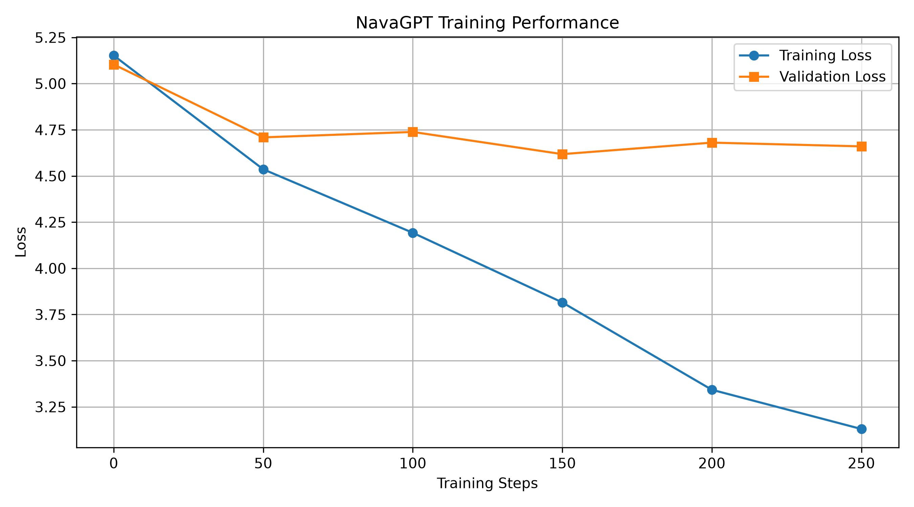

# NavaGPT
### A Lightweight GPT-Style Language Model Built from Scratch

NavaGPT is an educational implementation of a decoder-only Transformer language model developed using Python and PyTorch.

The project explores the core architecture behind Generative Pre-trained Transformers (GPT), including custom Byte Pair Encoding (BPE) tokenization, causal self-attention, Transformer blocks, next-token prediction, model training, evaluation, and text generation.

The objective is to understand how GPT-style language models work by implementing their fundamental components from scratch without using pretrained GPT weights or external AI APIs.

---

## Project Objectives

- Understand the architecture of GPT-style language models.
- Implement a decoder-only Transformer using PyTorch.
- Develop a custom BPE tokenizer.
- Implement multi-head causal self-attention.
- Train a language model using next-token prediction.
- Evaluate model performance using validation loss and perplexity.
- Generate text using temperature and top-k sampling.

## Architecture

NavaGPT follows a decoder-only Transformer architecture.

1. BPE Tokenization
2. Token Embeddings
3. Positional Embeddings
4. Multi-Head Causal Self-Attention
5. Feed-Forward Neural Network
6. Residual Connections
7. Layer Normalization
8. Language Modeling Head
9. Next-Token Prediction

## Technology Stack

- **Programming Language:** Python
- **Deep Learning Framework:** PyTorch
- **Data Processing:** NumPy, Pandas
- **Visualization:** Matplotlib
- **Development Environment:** VS Code
- **Version Control:** Git and GitHub

## Key Features

- Custom character-based BPE tokenizer with learned merge operations.
- Decoder-only Transformer architecture.
- Multi-head causal self-attention.
- Token and positional embeddings.
- GELU activation function.
- Residual connections and layer normalization.
- AdamW optimizer.
- Training and validation loss tracking.
- Perplexity-based model evaluation.
- Text generation using temperature and top-k sampling.
- Automatic CPU/GPU device selection.

## Project Structure

```text
NavaGPT/
│
├── src/
│   ├── __init__.py
│   ├── tokenizer.py
│   ├── bpe_tokenizer.py
│   ├── attention.py
│   ├── transformer.py
│   ├── model.py
│   └── generation.py
│
├── data/
│   └── input.txt
│
├── experiments/
│   ├── training_history.csv
│   └── training_loss.png
│
├── checkpoints/
│
├── notebooks/
│
├── train.py
├── chat.py
├── evaluate.py
├── plot_training.py
├── requirements.txt
├── README.md
├── .gitignore
└── LICENSE
```

## Installation and Setup

### 1. Clone the repository

```bash
git clone https://github.com/rohinirpawar2527/NavaGPT.git
cd NavaGPT
```

### 2. Create a virtual environment

```bash
python -m venv .venv
```

### 3. Activate the environment

For Windows PowerShell:

```powershell
.venv\Scripts\Activate.ps1
```

### 4. Install dependencies

```bash
pip install -r requirements.txt
```

## Model Training

Place your training text inside:

```text
data/input.txt
```

Run the training script:

```bash
python train.py
```

The training process:
- Builds the BPE vocabulary.
- Converts text into token IDs.
- Splits data into training and validation sets.
- Trains the Transformer using next-token prediction.
- Tracks training and validation loss.
- Saves the trained model checkpoint.

The checkpoint is saved at:

```text
checkpoints/navagpt.pth
```

Training history is saved at:

```text
experiments/training_history.csv
```

## Text Generation

To generate text using the trained model:

```bash
python chat.py
```

The model generates text based on a predefined prompt using temperature and top-k sampling.

## Model Evaluation

Run:

```bash
python evaluate.py
```

The evaluation script calculates:

- Validation Loss
- Perplexity

### Latest Experimental Results

| Metric | Result |
|---|---:|
| Vocabulary Size | 143 |
| Training Iterations | 300 |
| Validation Loss | 4.6565 |
| Perplexity | 105.2663 |
| Training Device | CPU |

*Results are from the current small experimental dataset and model configuration.*

## Training Performance

NavaGPT records training and validation loss to monitor learning progress and generalization.



The training curve shows a consistent reduction in training loss. Validation loss fluctuates and stabilizes, suggesting potential overfitting due to the limited training dataset.

To regenerate the graph:

```bash
python plot_training.py
```

## Current Limitations

- Trained on a small educational text dataset.
- Uses a lightweight character-based BPE implementation.
- Limited vocabulary and context length.
- Text generation quality is experimental.
- No large-scale pretraining.
- Not suitable for production-level conversational applications.

NavaGPT is an educational language-model implementation and is not comparable to large-scale pretrained GPT systems.

## Future Improvements

- Expand the training corpus.
- Improve the tokenizer and unknown-character handling.
- Experiment with larger Transformer configurations.
- Implement regularization and early stopping.
- Explore GPU-based training using Google Colab.
- Add interactive chatbot functionality.
- Experiment with multilingual text generation.
- Compare different model configurations and evaluation metrics.

## Author

**Rohini Pawar**  
Third Year B.E. – Artificial Intelligence and Machine Learning  
AISSMS College of Engineering

## License

This project is licensed under the MIT License.
